# Kế Hoạch Triển Khai: Chuyển Đổi Sang Dear ImGui + Metal (DarkPubg)

## [Goal Description]
Dự án DarkPubg hiện tại sử dụng **UIKit** kết hợp hàng trăm `CALayer`, `CAShapeLayer`, `CATextLayer` và `CADisplayLink` (60Hz) để hiển thị ESP. Mặc dù hoạt động ổn định nhưng việc cập nhật thủ công hàng loạt thuộc tính CoreAnimation (`UIBezierPath`, `CAShapeLayer.path`, `CATextLayer.string`, `CATransaction`) gây tiêu hao CPU và có thể giật lag khi có nhiều đối tượng (đặc biệt khi vẽ vòng tròn sát thương 3D 32 đoạn và đường bay parabol của quả bom).

Mục tiêu của thay đổi này là:
1. **Chuyển đổi toàn bộ hệ thống vẽ Overlay** sang **Dear ImGui (Metal Backend - `MTKView`)** chạy trực tiếp trên GPU với tần số quét 60Hz / 120Hz ProMotion mượt mà tuyệt đối.
2. **Tích hợp Menu ImGui trực quan** với giao diện Tab hiện đại, có nút nổi (Floating Button) để bật/tắt menu.
3. **Giữ vững kiến trúc Kernel-level External:** Tiếp tục sử dụng `SBSAccessibilityWindowHostingController` trên SpringBoard để host context ID của cửa sổ Metal mà không cần inject mã vào game.
4. **Cơ chế xuyên cảm ứng (Touch Pass-through) hoàn hảo:** Khi Menu đóng, toàn bộ màn hình xuyên cảm ứng để chơi game bình thường; khi chạm vào Floating Button hoặc Menu ImGui thì nhận tương tác đầy đủ.

---

## User Review Required
> [!IMPORTANT]
> - **Chuyển giao quyền vẽ:** Toàn bộ việc vẽ ESP người chơi, xương, lựu đạn 3D, vật phẩm sẽ được chuyển từ `CALayer` sang `ImDrawList` của Dear ImGui.
> - **Cấu hình Compiler:** Bổ sung `-framework Metal -framework MetalKit` và đường dẫn thư viện `imgui` vào `supports/darksword.xcconfig`.
> - **Cảm ứng Pass-through:** Cửa sổ `DSImGuiWindow` sẽ ghi đè `hitTest:withEvent:`: trả về `nil` đối với các điểm chạm ngoài Floating Button và Menu để game nhận 100% thao tác điều khiển.

---

## Open Questions
Hiện tại không còn câu hỏi mở nào. Người dùng đã xác nhận các lựa chọn:
1. Chuyển toàn bộ (cả ESP lẫn Menu) sang ImGui Metal.
2. Sử dụng Floating Button để bật/tắt Menu ImGui.
3. Ưu tiên tối ưu hóa cho PUBG Mobile (DarkPubg) trước.

---

## Proposed Changes

```mermaid
flowchart TD
    subgraph Config["1. Build Configuration"]
        XC["supports/darksword.xcconfig"] --> LD["Thêm -framework Metal -framework MetalKit\nThêm HEADER_SEARCH_PATHS imgui"]
    end

    subgraph CoreImGui["2. ImGui Metal Bridge"]
        IMGUI_INC["darksword/DSBridgeImGui.inc.mm"]
        IMGUI_CPP["imgui/imgui.cpp\nimgui_draw.cpp\nimgui_widgets.cpp\nimgui_impl_metal.mm"]
        IMGUI_INC --> IMGUI_CPP
    end

    subgraph MetalView["3. Metal MTKView & Window"]
        VIEW["DSImGuiView (MTKViewDelegate)"]
        WIN["DSImGuiWindow (Touch Pass-through hitTest)"]
        VIEW --> WIN
        WIN --> SB["SBSAccessibilityWindowHostingController (SpringBoard)"]
    end

    subgraph RenderLoop["4. ImGui Render Pipeline"]
        SNAPSHOT["Snapshot Lock (g_dspubgPlayers, g_dspubgGrenades, g_dspubgItems)"]
        MTK_DRAW["drawInMTKView"]
        ESP_DRAW["ImDrawList ESP (Box, Skeleton, Grenade 3D, Items)"]
        MENU_DRAW["ImGui Menu & Floating Button"]
        SNAPSHOT --> MTK_DRAW
        MTK_DRAW --> ESP_DRAW
        MTK_DRAW --> MENU_DRAW
        MENU_DRAW --> PRESENT["Metal Present Drawable (60/120 FPS)"]
    end
```



---

### Component 1: Build Configuration & Compiler Flags

#### [MODIFY] [supports/darksword.xcconfig](file:///home/dungle/LienQuanDS/supports/darksword.xcconfig)
- Thêm `$(SRCROOT)/imgui` vào `HEADER_SEARCH_PATHS` và `USER_HEADER_SEARCH_PATHS`.
- Bổ sung `-framework Metal -framework MetalKit` vào `OTHER_LDFLAGS`.

```diff
- HEADER_SEARCH_PATHS = $(inherited) $(SRCROOT)/Auth $(SRCROOT)/darksword $(SRCROOT)/Vendor/darksword-headers $(SRCROOT)/Vendor/darksword-lib/choma $(SRCROOT)/Vendor/darksword-kexploit $(SRCROOT)/Vendor/darksword-kexploit/pe $(SRCROOT)/Vendor/darksword-kexploit/TaskRop $(SRCROOT)/headers
- USER_HEADER_SEARCH_PATHS = $(inherited) $(SRCROOT)/Auth $(SRCROOT)/darksword $(SRCROOT)/Vendor/darksword-headers $(SRCROOT)/Vendor/darksword-lib/choma $(SRCROOT)/Vendor/darksword-kexploit $(SRCROOT)/Vendor/darksword-kexploit/pe $(SRCROOT)/Vendor/darksword-kexploit/TaskRop
- OTHER_LDFLAGS = $(inherited) -lxpf -lgrabkernel2 -framework AVFoundation
+ HEADER_SEARCH_PATHS = $(inherited) $(SRCROOT)/imgui $(SRCROOT)/Auth $(SRCROOT)/darksword $(SRCROOT)/Vendor/darksword-headers $(SRCROOT)/Vendor/darksword-lib/choma $(SRCROOT)/Vendor/darksword-kexploit $(SRCROOT)/Vendor/darksword-kexploit/pe $(SRCROOT)/Vendor/darksword-kexploit/TaskRop $(SRCROOT)/headers
+ USER_HEADER_SEARCH_PATHS = $(inherited) $(SRCROOT)/imgui $(SRCROOT)/Auth $(SRCROOT)/darksword $(SRCROOT)/Vendor/darksword-headers $(SRCROOT)/Vendor/darksword-lib/choma $(SRCROOT)/Vendor/darksword-kexploit $(SRCROOT)/Vendor/darksword-kexploit/pe $(SRCROOT)/Vendor/darksword-kexploit/TaskRop
+ OTHER_LDFLAGS = $(inherited) -lxpf -lgrabkernel2 -framework AVFoundation -framework Metal -framework MetalKit
```

---

### Component 2: ImGui Metal Bridge & Overlay View

#### [NEW] [darksword/DSBridgeImGui.inc.mm](file:///home/dungle/LienQuanDS/darksword/DSBridgeImGui.inc.mm)
File này đóng vai trò là lõi Metal + ImGui:
1. **Compile Unity:** Nhúng mã nguồn ImGui:
   ```objc
   #include "imgui.h"
   #include "imgui_impl_metal.h"
   #include "imgui.cpp"
   #include "imgui_draw.cpp"
   #include "imgui_tables.cpp"
   #include "imgui_widgets.cpp"
   #include "imgui_impl_metal.mm"
   ```
2. **`DSImGuiWindow` & Pass-Through HitTest:**
   - Cửa sổ `UIWindow` kế thừa kiểu hệ thống bảo mật để SpringBoard có thể host (`_isSystemWindow`, `_isSecure`, `keepContextInBackground`).
   - Cung cấp `hitTest:withEvent:`:
     - Nếu chạm vào Floating Button: nhận cảm ứng để kéo thả hoặc mở Menu.
     - Nếu Menu đang mở và chạm trong khung Menu: nhận cảm ứng để tương tác UI.
     - Nếu chạm ra ngoài: trả về `nil` để xuyên hoàn toàn xuống game PUBG Mobile.
3. **`DSImGuiView` (`MTKView`):**
   - Khởi tạo Metal Device (`MTLCreateSystemDefaultDevice()`), `MTLCommandQueue`.
   - Thiết lập `clearColor = MTLClearColorMake(0, 0, 0, 0)`, `opaque = NO`.
   - Cài đặt ImGui Style (Giao diện tối chuyên nghiệp, bo góc mềm mại).
   - Xử lý Touch Events (`touchesBegan`, `touchesMoved`, `touchesEnded`) đẩy vào `ImGui::GetIO()`.
4. **Vẽ ESP bằng `ImDrawList` trong `drawInMTKView:`:**
   - **Player Box:** `draw->AddRect()` (Box 2D góc hoặc viền).
   - **Skeleton:** Nối các khớp xương `head`, `neck`, `chest`, `pelvis`, tay, chân với `draw->AddLine()`.
   - **Health Bar:** `draw->AddRectFilled()` với thanh máu tự động đổi màu theo % máu.
   - **Tên, khoảng cách, Team ID, vũ khí:** `draw->AddText()`.
   - **Grenade Trajectory:** Chuỗi `draw->AddLine()` nối các điểm tọa độ bay thực tế `trajPoints`.
   - **Grenade 3D Circle:** Thuật toán `Circle3D` 32 điểm góc quay nối thành vòng tròn 3D trên mặt đất.
   - **Grenade Timer & Icon:** Icon quả bom chuyển màu mượt mà từ vàng tươi sang đỏ cùng số giây đếm ngược.
   - **Items & Vehicles:** Hiển thị tên vật phẩm và xe theo nhóm màu.
5. **Vẽ Menu ImGui & Floating Button:**
   - **Floating Button:** Vòng tròn nhỏ có chữ `D3S` / `PUBG` nằm ở góc màn hình, có thể kéo di chuyển vị trí. Bấm vào để toggle mở/đóng Menu.
   - **Menu Cài Đặt:** Cửa sổ `ImGui::Begin("DarkPubg Menu", ...)` gồm 4 Tab:
     - *Tab 1 (ESP Người):* Bật/tắt Box, Xương, Dây, Máu, Tên, Khoảng cách, Bot.
     - *Tab 2 (Lựu Đạn):* Đường bay Parabol, Vòng 3D, Icon & Đếm giây.
     - *Tab 3 (Vật Phẩm & Xe):* Lọc súng, giáp mũ, đạn, xe cộ.
     - *Tab 4 (Cài Đặt):* Độ dày nét vẽ, cỡ chữ, màu sắc.

---

### Component 3: Tích hợp vào Entry Point và Build Script

#### [MODIFY] [build-darkspeed.sh](file:///home/dungle/LienQuanDS/build-darkspeed.sh)
- Thêm `darksword/DSBridgeImGui.inc.mm` vào danh sách `bridge_fragments` để kiểm tra toàn vẹn trước khi build.

```diff
 bridge_fragments="
 darksword/DSBridgeExploit.inc.mm
 darksword/DSBridgeESP.inc.mm
 darksword/DSBridgeLienQuan.inc.mm
 darksword/DSBridgePUBG.inc.mm
+darksword/DSBridgeImGui.inc.mm
 "
```

#### [MODIFY] [darksword/DSBridge.mm](file:///home/dungle/LienQuanDS/darksword/DSBridge.mm)
- `#include "DSBridgeImGui.inc.mm"`
- Trong hàm `DSBridgeStartHostedHUD()`: Khởi tạo `DSImGuiWindow`, lấy `contextId` và đăng ký với SpringBoard qua `SBSAccessibilityWindowHostingController`.

---

## Verification Plan

### Automated Build Verification
1. **Kiểm tra biên dịch cục bộ và kiểm tra fragments:**
   ```bash
   ./build-darkspeed.sh --verify-only || true
   ```
2. **Commit và đẩy lên GitHub Actions:**
   - Giám sát tiến trình biên dịch `Build Release` trên runner `macos-15`.
   - Đảm bảo các thư viện `Metal`, `MetalKit` và toàn bộ mã nguồn Dear ImGui biên dịch thành công 100% không cảnh báo lỗi liên kết.
3. **Tải và kiểm tra gói IPA:**
   - Kiểm tra kích thước và cấu trúc IPA tại `packages/DarkPubg_1.0-1.ipa`.

### Manual In-Game Verification
1. **Kiểm tra hiển thị ImGui Overlay:**
   - Mở game PUBG Mobile, bấm nút OPEN HUD.
   - Kiểm tra nút tròn Floating Button xuất hiện trên màn hình.
   - Chạm vào màn hình game để bắn, di chuyển, xoay góc nhìn -> Xác nhận cảm ứng xuyên qua bình thường 100% không bị cản trở.
2. **Kiểm tra Menu ImGui:**
   - Bấm vào nút Floating Button -> Menu ImGui mở ra với các Tab chức năng.
   - Thử kéo cửa sổ Menu, tick chọn/bỏ chọn các checkbox -> Xác nhận Menu nhận cảm ứng mượt mà.
   - Bấm lại nút Floating Button -> Menu ẩn đi.
3. **Kiểm tra ESP & Độ mượt:**
   - Vào phòng tập (Training Grounds) hoặc trận đấu:
     - Kiểm tra khung người (Box), bộ xương (Skeleton) bám sát người chơi.
     - Ném thử quả bom nổ: Kiểm tra đường bay hình parabol vẽ mượt bằng Metal GPU và vòng tròn sát thương 3D 32 đoạn không bị khựng lag.
     - Kiểm tra icon quả bom chuyển màu mượt mà từ vàng sang đỏ và đếm ngược đúng 5.0 giây.
